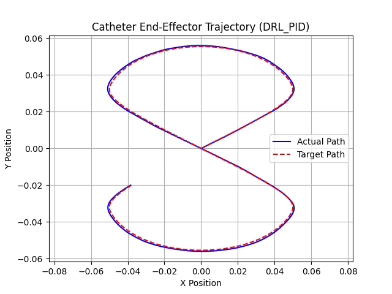
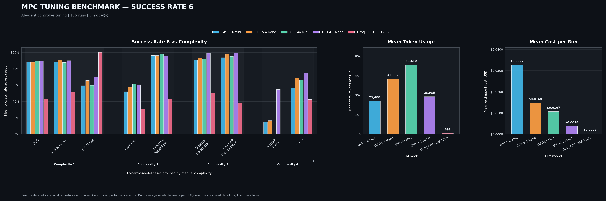
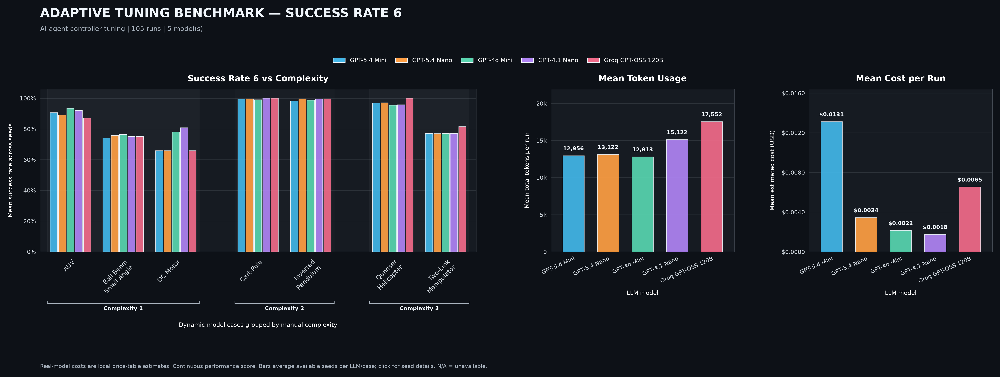

# Kourosh Moeini — Robotics & Control Portfolio

Selected work in magnetic soft robotics, reinforcement-learning control, physics-informed modelling, simulation and experimental evaluation.

I am a mechatronics engineer based in Novi Sad, Serbia. My MSc research at Sharif University of Technology focused on controlling a magnetic soft catheter: linking Python/PyTorch learning code to MATLAB mechanics, evaluating controllers, and transferring a trained policy to a physical setup. My current work includes benchmark design, testing and analysis for team-developed agentic control modules.

## Magnetic-catheter tracking

**Hybrid DDPG + PID:** the actual and desired tip paths closely overlap in this saved simulation. [Watch the tracking video](01_Wrench_DDPG_PID/media/hybrid_wrench_infinity_tracking.mp4) · [Watch the 3D simulation](01_Wrench_DDPG_PID/media/hybrid_wrench_infinity_simulation_3D.mp4).

## Projects

| Project | What it covers | Main tools |
|---|---|---|
| [Wrench control and DDPG/PID feedback](01_Wrench_DDPG_PID/README.md) | Learned tip-position-to-wrench mapping and closed-loop tracking comparisons | Python, PyTorch, MATLAB |
| [PINN catheter modelling](02_PINN_Catheter_Modelling/README.md) | Accepted static-modelling manuscript; final implementation is currently unavailable | Physics-informed learning, Cosserat models |
| [External-magnet control at 10 Hz](03_External_Magnet_Control_10Hz/README.md) | Simulation-trained catheter-tip control through an external magnet | Python, PyTorch, MATLAB Engine |
| [Experimental transfer and online fine-tuning](04_Experimental_Transfer_Online_Tuning/README.md) | Six-DOF robot-mounted magnet, stereo tip tracking and learned-policy adaptation | Robotics, stereo calibration, PyTorch |
| [Five-DOF tip control](05_Five_DOF_Tip_Control/README.md) | Tip position and direction control with six magnet-motion action components | Python, PyTorch, MATLAB |
| [Agentic control benchmarks](06_Agentic_Control_Benchmarks/README.md) | Benchmark cases, experiment workflows, tests, metrics and comparisons | Python, MPC, adaptive control, system identification |
| [SOFA catheter simulation](07_SOFA_Catheter_Simulation/README.md) | Dynamic beam mechanics coupled to external magnetic actuation | SOFA, SofaPython3, BeamAdapter |

Read [PROJECT_OVERVIEW.txt](PROJECT_OVERVIEW.txt) for the full plain-language description. For an offline visual guide with playable videos, download the repository using **Code → Download ZIP**, extract it, and open `PORTFOLIO.html` in a browser. GitHub displays the HTML source rather than hosting that guide as a website.

## Benchmark examples

My contribution is the benchmark design, dynamic-system cases, testing, experiment setup, metrics and reporting. The team supplies the core controller and identification modules.

### MPC

[Robot-arm state regulation](06_Agentic_Control_Benchmarks/media/mpc_two_link_manipulator_states.png) · [Control inputs](06_Agentic_Control_Benchmarks/media/mpc_two_link_manipulator_inputs.png) · [Seed variability](06_Agentic_Control_Benchmarks/media/mpc_score6_seed_variability.png)

### Adaptive control

[Robot-arm state regulation](06_Agentic_Control_Benchmarks/media/adaptive_two_link_manipulator_states.png) · [Control inputs](06_Agentic_Control_Benchmarks/media/adaptive_two_link_manipulator_inputs.png) · [Seed variability](06_Agentic_Control_Benchmarks/media/adaptive_score6_seed_variability.png)

These are saved experiment snapshots from October 2026. “Success Rate 6” is the archive's continuous performance score, rather than a binary pass percentage. Token/cost panels retain the historical local estimates. The system-identification examples and source details are in the [benchmark project notes](06_Agentic_Control_Benchmarks/README.md).

## What is included

- Short code extracts, original figures/videos, and notes explaining the control task and my contribution.
- Two manuscripts accepted for ICBME, with IEEE publication forthcoming: [hybrid DDPG/PID catheter tracking](01_Wrench_DDPG_PID/paper/Accepted_Hybrid_DDPG_PID_Manuscript.pdf) and [data-free static PINN modelling](02_PINN_Catheter_Modelling/paper/Accepted_Data_Free_Static_PINN_Manuscript.pdf).
- A compact [SOFA example](07_SOFA_Catheter_Simulation/code/dynamic_magnet_example/README.md), with its analytical magnetic-model/input tests.
- [Source hashes](SOURCE_MANIFEST.json) and [validation notes](VALIDATION.md), including the distinction between saved results and checks actually rerun.

This is a curated research sample. Full datasets, trained checkpoints, calibration files and university/team implementations are not all included. The private benchmark-driver reference is excluded from this public repository. The final static PINN code is unavailable; another notebook is not substituted for it. The experimental notebook selection is supported by exact matches between its saved outputs and thesis figures; the precise trained checkpoint remains unconfirmed.

The extracted notebooks are for review, with definitions retained as code and training/hardware launch cells shown as reference text. They are not complete, ready-to-run training packages. Opening them does not initiate a physical robot experiment. See each project README for dependencies and scope.

Separate public training example: [silo-system](https://github.com/Kourosh-Moeini/silo-system). Its agents are mocked; my contribution is the testing/reporting workflow, with the provided engine clearly distinguished.

## Background and contact

MSc in Mechatronics, Sharif University of Technology; BSc in Mechanical Engineering, Shahid Beheshti University. Additional experience includes ROS 2/Gazebo on Linux, legged-robot modelling in MSC ADAMS, SolidWorks and PLA printing, robotic arms, Arduino/ESP modules and magnetic sensing. Familiar with MuJoCo and TensorFlow.

[LinkedIn](https://www.linkedin.com/in/kourosh-moeini/) · [Google Scholar](https://scholar.google.com/citations?user=YHJffysAAAAJ&hl=en) · [GitHub](https://github.com/Kourosh-Moeini)  
Contact: **kourosh.moeini.aca@gmail.com**
